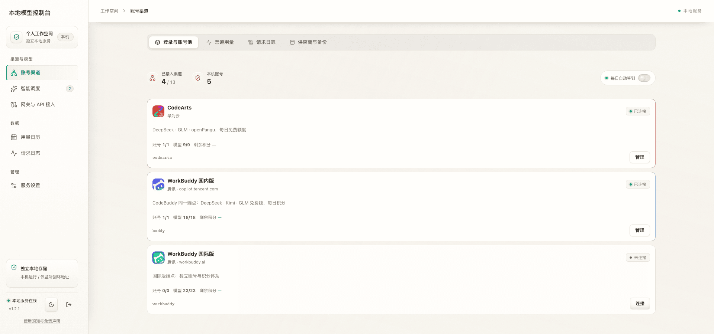
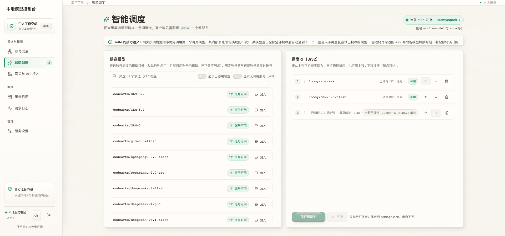
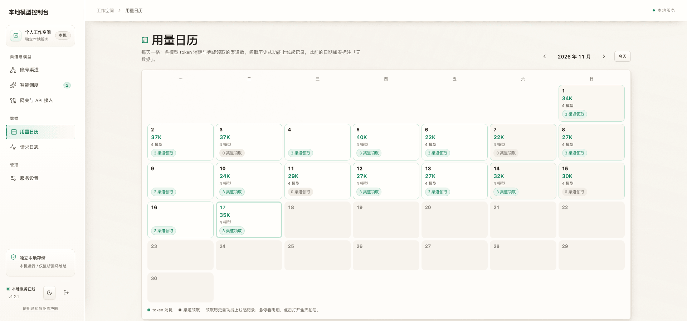
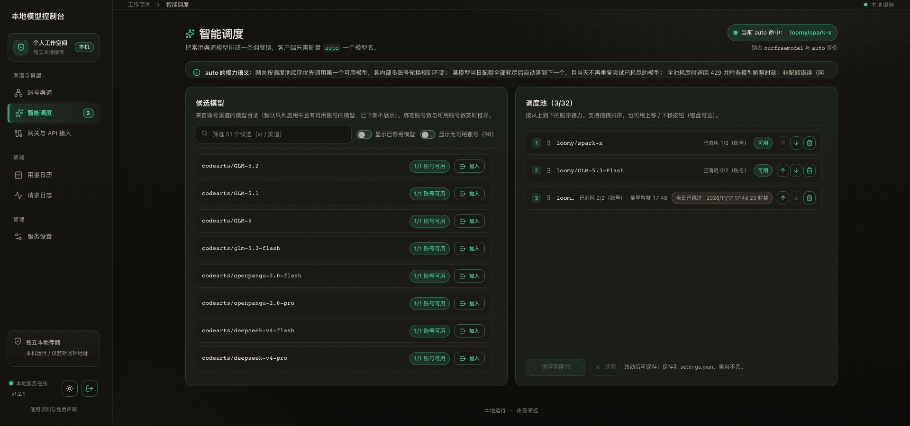

<div align="center">
  

# our-free-model-standalone

**简体中文** | [English](README_EN.md)

  
  
  <br>
</div>

> 一条命令把十三个免费账号渠道聚合成本机 OpenAI 兼容网关：
> `npx our-free-model-standalone`（短命令 `ofm`）。无需登录、注册或填 API Key。

**Our Free Model** 是一台跑在你自己机器上的「免费模型聚合网关」：

- **一个模型名 `auto`**：智能调度按你排定的顺序在渠道模型之间自动接力，
  某个模型当日配额耗尽后自动落到下一个，当天不再重复尝试；全池耗尽返回 429 并附各模型解禁时刻。
- **OpenAI 兼容 API**：`/v1/chat/completions`、`/v1/responses`、`/v1/messages` 与 `/v1/models`，
  现有客户端（IDE / 终端 / SDK）无需改动，把 Base URL 指向本机即可。
- **网页管理台**：模型与开关、账号渠道、智能调度、用量日历、请求日志、用量统计等页面，
  昼/夜双主题；只监听本机回环地址。
- **账号渠道**：Cline、TRAE、Qoder、Loomy、Gemini、MiniMax、ZCode、CodeArts、CodeBuddy、
  WorkBuddy、LobsterAI、Kilo 免费池与 EAC 协付等账号渠道，多账号轮换与积分领取历史内置。
- **零运行时依赖**：只需要 Node.js 22.19+/24+；数据全部保存在本机。

## 快速开始

```bash
npx our-free-model-standalone        # 或全局安装：npm i -g our-free-model-standalone && ofm
```

启动后按提示打开管理台，登录账号渠道，在「智能调度」页勾选模型并排序，
然后在你的客户端里把 Base URL 设为 `http://127.0.0.1:18900/v1`、模型名填 `auto`。

## 控制台预览

<table>
  <tr>
    <td align="center"></td>
    <td align="center"></td>
  </tr>
  <tr>
    <td align="center"></td>
    <td align="center"></td>
  </tr>
</table>

## 仓库结构

| 路径 | 内容 |
| --- | --- |
| `packages/standalone/` | 独立服务本体（CLI、HTTP 服务、管理 API、网页前端） |
| `src/` | 共享内核（转发管线、渠道抽象、存储、token 优化器） |
| `vendor/` | 渠道包与 magpie 引擎的固定版本资产 |
| `scripts/` | 构建 / 打包 / 测试脚本 |
| `docs/` | 设计与验证记录 |

## 开发

```bash
npm install --ignore-scripts
npm test                     # 全量离线套件
npm run typecheck            # 类型检查
npm run build:standalone-ui  # 构建管理台前端
npm run pack:standalone -- --node-license <Node-LICENSE>   # 本地打包
```

许可证见 `LICENSE` 与 `THIRD_PARTY_NOTICES.txt`。
