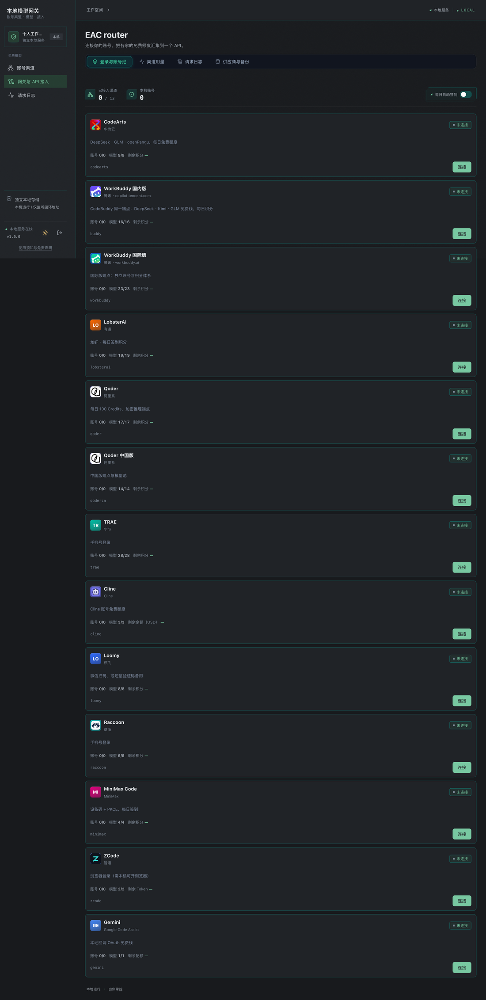

<div align="center">
  

# Our Free Model · 独立本地服务

**一条命令，在你自己的机器上跑一个带网页控制台的模型网关。**

不需要安装 DSH，不需要装客户端，运行时零 npm 依赖。

[](https://www.npmjs.com/package/our-free-model-standalone)
[](./LICENSE)
[](https://nodejs.org)
[](./package.json)

</div>

---

## 这是什么

一个跑在**本机**的 OpenAI 兼容网关：把各家的免费模型额度、以及你自己登录的账号渠道，
汇集成一个统一的 `/v1` 接口，供 IDE、命令行和脚本调用。

- **自带网页控制台**——启动后终端打印一条一次性管理链接，浏览器打开即可操作；
- **不需要 DSH**——与 [DSH 插件版](https://github.com/liuleiyu121520/dsh-our-free-model) 是两套独立程序，互不读取对方的配置与凭据；
- **默认只监听 `127.0.0.1`**——只有本机能访问；
- **凭据只落在本机数据目录**，不上传任何服务器；
- **零运行时依赖**——只用 Node 内置模块，装完不会拖进一棵依赖树。

> 本项目是个人学习与技术研究项目，按「现状」提供。**它不是模型提供方**：
> 所有回答都由你配置的第三方服务产生，额度、收费与可用性由对应服务方决定。

## 安装

```bash
npm install -g our-free-model-standalone
```

或者不安装，直接跑：

```bash
npx our-free-model-standalone
```

## 📷 界面

**网关与 API 接入**——选中模型，下方的调用示例即时跟着换；Base URL 与 API Key 一键复制。


**账号渠道**——13 个渠道统一管理：登录、账号池、每日签到、用量与备份。



## 快速开始

```bash
# 1. 启动（会打印一次性管理链接，并尝试自动打开浏览器）
ofm

# 2. 终端里会看到类似这样的输出：
#    本地模型网关 1.0.0
#    管理页面（10 分钟内一次性登录）：http://127.0.0.1:18900/#login=xxxxx
#    API：http://127.0.0.1:18900/v1
#    API Key 保存在：~/.our-free-model/settings.json

# 3. 浏览器打开管理链接 → 进入控制台 →「账号渠道」登录你想要的渠道

# 4. 把下面两样填进你的客户端
#    Base URL : http://127.0.0.1:18900/v1
#    API Key  : 在「网关与 API 接入」页点「查看密钥」
```

调用任何 OpenAI 兼容客户端都可以：

```bash
curl -X POST http://127.0.0.1:18900/v1/chat/completions \
  -H "Authorization: Bearer YOUR_API_KEY" \
  -H "Content-Type: application/json" \
  -d '{
    "model": "mimo-v2.6-flash-free",
    "messages": [{ "role": "user", "content": "你好" }]
  }'
```

## 命令与参数

安装后有**两个等价命令**：`our-free-model-standalone`（完整名）与 **`ofm`**（日常用这个）。

| 参数 | 作用 |
|---|---|
| `--port <端口>` | 监听端口，默认 `18900`；被占用时自动选可用端口 |
| `--data-dir <目录>` | 数据目录，默认 `OFM_HOME` 或 `~/.our-free-model` |
| `--no-refresh` | 跳过启动与周期的模型清单刷新 |
| `--lan` / `--no-lan` | 开启/关闭局域网推理中继（管理页仍仅限本机） |
| `--lan-port <端口>` | 局域网中继端口 |
| `--help` | 显示全部选项 |

## 数据与鉴权

| 项 | 说明 |
|---|---|
| 数据目录 | 默认 `~/.our-free-model`，可用 `--data-dir` 或 `OFM_HOME` 覆盖 |
| 管理登录 | 一次性链接（10 分钟内有效、只能兑换一次），或使用本机保存的管理令牌 |
| API 鉴权 | `Authorization: Bearer <API Key>`；Key 保存在数据目录的 `settings.json` |
| 监听地址 | 默认仅回环地址，不对外暴露 |
| 与 DSH 的关系 | 完全独立：不读 DSH 的配置或凭据库；你在插件里的账号不会自动出现在这里 |

> ⚠️ 若把数据目录指向**符号链接路径**（例如 macOS 的 `/tmp` 实为 `/private/tmp`），
> 服务会拒绝启动并报 `Symlinks are not allowed in managed storage`。请使用真实路径。

## 第一次打开时会发生什么

1. **使用须知与免责声明**——读一次即可，之后从侧边栏可随时重看；
2. **DSH 账号导入提示**——如果检测到本机 DSH 插件里已有账号，会问你是否一键导入。
   导入是**整体替换**，会覆盖本服务当前的账号列表（插件那边的原账号不受影响）。
   **这个提示只在首次询问一次**，点过「稍后」后不再打扰；想导入随时去「账号渠道」页手动操作。

## 常见问题

**Q：和 DSH 插件版有什么区别？**
独立服务是一个单独的程序，不需要 DSH、不需要 profile，一条命令启动；插件版则挂载在 DSH 内部。
两者功能重叠但彼此独立，可以同时安装。npm 上发布的是**独立服务**。

**Q：需要自己填 API Key 吗？**
不需要。它聚合各渠道的免费额度，以及你自己登录的账号渠道。具体能用哪些模型，见控制台「网关与 API 接入」页。

**Q：端口被占用？**
默认会自动挑选可用端口；也可以 `--port 指定`。

**Q：数据在哪、怎么备份？**
`~/.our-free-model`。控制台「账号渠道 → 供应商与备份」里可以导出/导入备份。

## 仓库与上游

| | |
|---|---|
| **本包仓库（fork）** | https://github.com/liuleiyu121520/dsh-our-free-model |
| **独立服务源码** | [`packages/standalone`](https://github.com/liuleiyu121520/dsh-our-free-model/tree/main/packages/standalone) |
| **问题反馈** | https://github.com/liuleiyu121520/dsh-our-free-model/issues |
| **上游项目** | [Ebony-Vinyl/dsh-our-free-model](https://github.com/Ebony-Vinyl/dsh-our-free-model) |

### 关于本 fork

本项目基于上游 [Ebony-Vinyl/dsh-our-free-model](https://github.com/Ebony-Vinyl/dsh-our-free-model)（MIT）。
**本 fork 与上游的差异，仅在于渠道的取舍**：上游移除了 WorkBuddy 国内版、WorkBuddy 国际版与
华为云（Huawei Cloud MaaS / CodeArts）渠道，本 fork 把它们恢复为可用。

上游移除的原因是该适配会以对应桌面客户端的身份签名请求，上游不愿承担此风险；
本 fork 把这一选择交回给使用者——**相应风险同样由使用者承担**。

除渠道取舍外，本 fork 另含两处上游尚未合并的修复：腾讯系内容级风控（`11128`）的 system
提示词等义改写，以及 Gemini 工具参数 schema 的 `items` 收敛。

**版权与许可**：MIT，原作者版权声明保留在 [LICENSE](./LICENSE) 中，未重新授权。
第三方组件与渠道包来源见包内 `scripts/standalone-third-party.txt` 与
`vendor/channel-pack/NOTICE.md`。

## 免责声明

使用本程序即表示你理解并同意：

- 本程序**不含任何模型能力**，只是在你本机做协议适配与请求路由；
- 模型额度、可用性、是否收费、是否符合服务商条款，全部由对应服务方决定；
- 你主动导入或登录得到的凭据只写入本机数据目录，不会上传；
- 请确保你的使用方式符合对应服务的条款与所在地法律，由此产生的封禁、扣费或其他损失由使用者自行承担；
- 本项目不对正确性、稳定性或特定用途适用性作任何担保。

完整条款见控制台内「使用须知与免责声明」。

## License

[MIT](./LICENSE) · Copyright (c) 2026 Ebony-Vinyl
