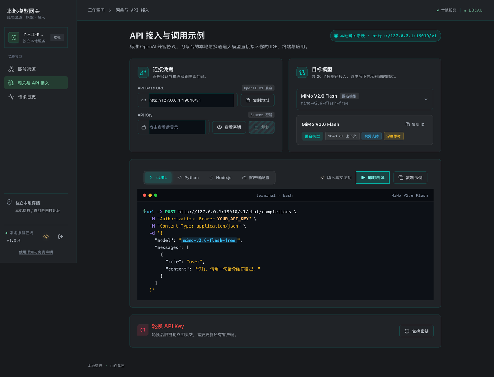

<div align="center">

# Our Free Model

**命令行模型网关 —— 一条命令，在你自己机器上跑起一个带网页控制台的 OpenAI 兼容网关。**

[](https://www.npmjs.com/package/our-free-model-standalone)
[](https://nodejs.org)
[](https://www.npmjs.com/package/our-free-model-standalone)
[](https://github.com/liuleiyu121520/dsh-our-free-model/blob/main/LICENSE)

</div>

## 安装并启动

```bash
npm i -g our-free-model-standalone
ofm
```

不安装也可以：`npx our-free-model-standalone`

启动后终端打印一次性管理链接（10 分钟内有效），浏览器打开即可。API 地址是
`http://127.0.0.1:18900/v1`，API Key 在控制台「网关与 API 接入」页查看。



## 它做什么

把各家免费模型额度与你登录的账号渠道，汇集成一个 `/v1` 接口，供 IDE、命令行和脚本调用。

- **13 个账号渠道**统一管理：登录、账号池、每日签到、用量与备份
- **OpenAI 兼容**：`/v1/chat/completions`、`/v1/responses`，任何兼容客户端直接接
- **自带网页控制台**，不需要另装界面
- **零运行时依赖**，只用 Node 内置模块
- **默认只监听 `127.0.0.1`**，凭据只落在本机数据目录

## 常用参数

```bash
ofm --port 18900            # 指定端口（占用时自动换）
ofm --data-dir ~/ofm-data   # 数据目录，默认 ~/.our-free-model
ofm --no-refresh            # 不自动刷新模型清单
ofm --help                  # 全部选项
```

## 仓库

- **源码**：[liuleiyu121520/dsh-our-free-model](https://github.com/liuleiyu121520/dsh-our-free-model)（命令行工具在 [`packages/standalone`](https://github.com/liuleiyu121520/dsh-our-free-model/tree/main/packages/standalone)）
- **问题反馈**：[Issues](https://github.com/liuleiyu121520/dsh-our-free-model/issues)
- **DSH 插件入口**（可选，独立产品）：[Ebony-Vinyl/dsh-our-free-model](https://github.com/Ebony-Vinyl/dsh-our-free-model)

> 与上游的关系：源自 [Ebony-Vinyl/dsh-our-free-model](https://github.com/Ebony-Vinyl/dsh-our-free-model)（MIT，版权声明保留、未重新授权），
> 差异仅在渠道取舍——恢复了上游移除的 WorkBuddy 国内版/国际版与华为云渠道，风险由使用者承担。
> 完整说明见[仓库 README](https://github.com/liuleiyu121520/dsh-our-free-model#readme)。

## 免责

个人学习与技术研究项目，按「现状」提供，**不是模型提供方**：所有回答由你配置的第三方服务产生，
额度与可用性由对应服务方决定。使用时请遵守各地法律与服务商条款，风险自负。
